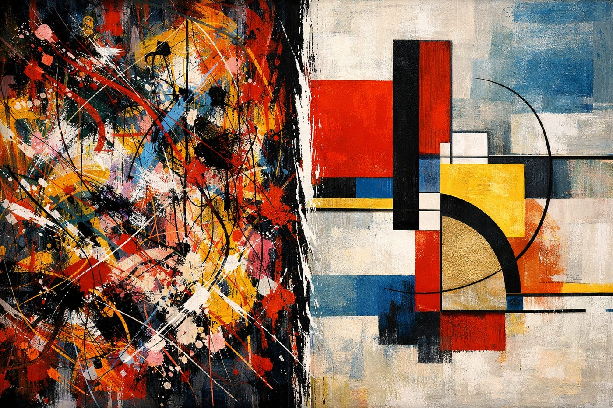

Abstract art carries a peculiar curse: everyone thinks they can spot a fraud, but few know how to spot quality. One person looks at an abstract painting and calls it brilliant. Another says, "My nephew could do that with a mop and a head injury." As usual, both may be wrong.

The common mistake is judging abstraction by the standards of representation. People ask what a painting is "supposed to be," as if every canvas owes us a horse, a bowl of fruit, or a saint mildly inconvenienced by martyrdom. But abstraction is rarely trying to depict an object. It is trying to build an experience through form, color, movement, surface, rhythm, and tension. So the real question is not, "What does it represent?" It is, "Does it hold together as a work of art?"

That distinction separates a well executed abstract work from a poor one.

#Intentionality vs. Arbitrariness

A strong abstract work feels intentional. Not predictable, not safe, not tidy. Intentional. It can be wild, raw, ugly, lyrical, violent, meditative, fractured, ecstatic, or severe. Still, it feels as if every choice was made for a reason. The choices relate to one another. The marks speak the same language, even when they argue. The color has logic. The structure has pulse. The surface has purpose.

A weak work feels arbitrary. That does not mean messy. Plenty of excellent paintings are messy. It means the mess reveals indecision rather than conviction. The composition drifts. The colors do not converse. The marks pile up without hierarchy or necessity. It stops feeling like a painting and starts feeling like evidence that something happened.

#Composition

Composition makes the difference most visible. In a strong piece, the eye moves with purpose. It may roam, pause, crash, circle back, or ricochet across the surface, but it does not simply wander off and die in a cul-de-sac. There is direction, emphasis, weight, pressure, rest, and release. Even when the composition is asymmetrical or unstable, that instability feels deliberate. The artist is controlling the tension, not merely recording it.

In weak abstraction, that structure is missing. Everything is equally loud, which is another way of saying nothing matters. Or everything is equally timid, which is visual beige in a more expensive outfit. There is no rhythm, no hierarchy, no sense that one area needs another. The painting can look busy without being rich. Activity is not depth. A traffic jam is active. That does not make it a symphony.

#Color

Color is another clear tell. In strong abstract art, color is not merely chosen. It is organized. Hue, value, saturation, temperature, and contrast work together to create pressure and meaning. A red beside black behaves differently than a red interrupted by chalky grey or cooled by a blue green field. These are not cosmetic decisions. They shape the emotional and structural force of the work.

In poor abstraction, color often feels impulsive or decorative. It is picked because it looks dramatic, fashionable, or pleasing on its own, not because it belongs to the larger logic of the painting. A metallic accent or high contrast scheme may grab attention quickly, but if the color relationships have no deeper structure, the effect wears off fast. The painting seduces at ten feet and collapses at two.

#Mark-Making

Mark-making matters just as much. Good marks carry consequence. They show pressure, speed, hesitation, force, revision, or restraint. They feel necessary to the painting. Weak marks often feel borrowed, gestures performed because they look expressive, not because they are needed. There is a world of difference between a mark that reveals thought and a mark that merely advertises "artist at work."

#Surface

Surface is equally important. Abstract painting lives and dies on material intelligence. Thick passages, thin veils, drag, scrape, stain, drybrush, matte, gloss, exposed ground: these are not side issues. They are part of the structure. They shape how the work breathes. A strong painting uses its materials with specificity. A weak one often has a generic, unconsidered surface that could belong to almost anyone.

#Editing

Then there is editing, where many paintings either mature or perish. Strong abstract work is edited. That does not always mean simplified. It means the artist has decided what deserves to stay, what should be buried, what must be sharpened, and what needs to be sacrificed. Weak work often preserves too much. Every gesture remains because the artist is afraid to lose evidence of effort. But effort is not the same as resolution. A painting improves when unnecessary moves are removed, not when every impulse is embalmed for public viewing.

#Spontaneity and Discernment

One of the most common misconceptions is that spontaneity excuses everything. It does not. Spontaneity can be powerful, but only when governed by discernment. A good artist knows when an accident has meaning and when it is merely an accident. A poor artist often mistakes randomness for freedom and leaves the canvas littered with untamed impulse. Freedom without judgment is not liberation. It is chaos with a flattering press release.

#Identity and Presence

What makes a strong abstract work memorable is identity. Something remains after you leave it: a rhythm, a pressure, a color chord, a structural tension, a visual scar. It does not evaporate the moment you turn away. It has a distinct presence. A weak work is often interchangeable. Shift a shape, swap a color, erase a line, add a scribble, and nothing essential changes, because nothing essential was ever established.

#Technique, Emotion, and Necessity

That is why technique alone is not enough. Clean edges, refined glazing, expensive surfaces, and tasteful palettes do not guarantee a good painting. Neither does raw emotion. Feeling deeply while making the work may matter to the artist, but the viewer can only judge what actually made it onto the surface. Emotion must be translated into form. Otherwise it remains private weather.

A good abstract work transforms choice into necessity. A poor one leaves choice looking random.

#
Conclusion
In the end, that is the clearest test. Does the painting feel authored? Does it feel as though it had to become itself? Or does it feel like one version among a thousand interchangeable outcomes? Strong abstraction creates inevitability. Weak abstraction creates leftovers.

Abstract art is not easier because it does not describe the visible world. In many ways, it is harder. It has nowhere to hide. Without recognizable subject matter to lean on, every decision carries more weight. Composition must carry its own body. Color must justify itself. Surface must speak. Rhythm must hold. The work must earn its existence through internal coherence, not borrowed narrative.

So no, the real difference between well executed and poorly executed abstraction is not whether the viewer "gets it." The difference is whether the painting knows what it is doing.

And the good ones do.
